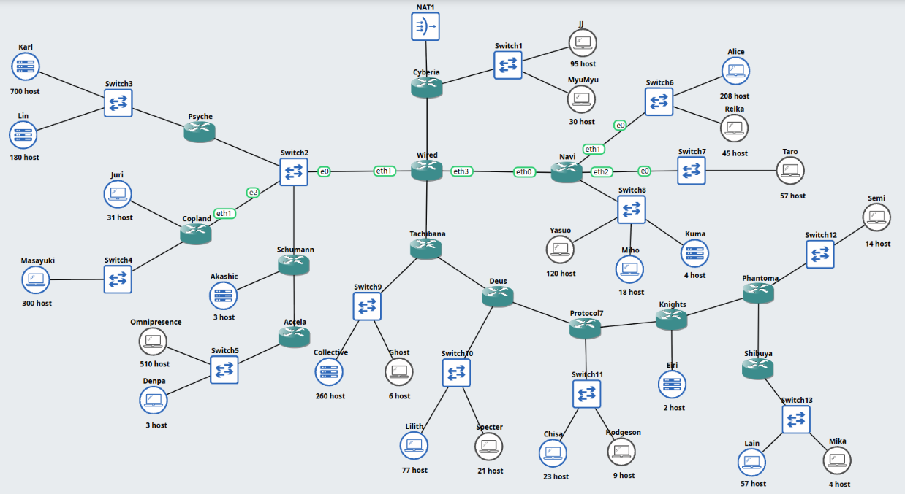
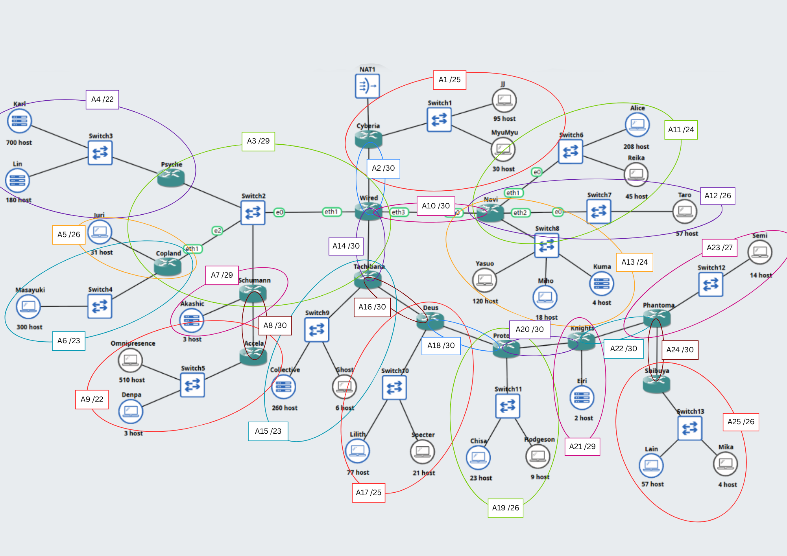
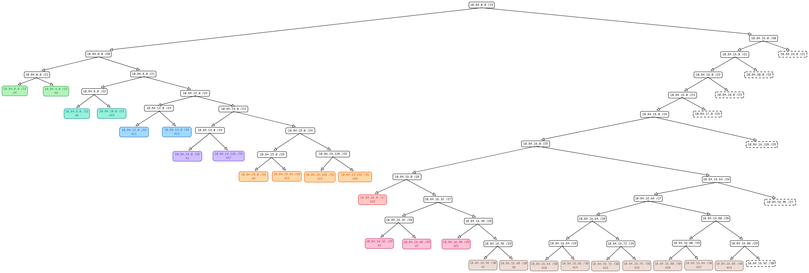
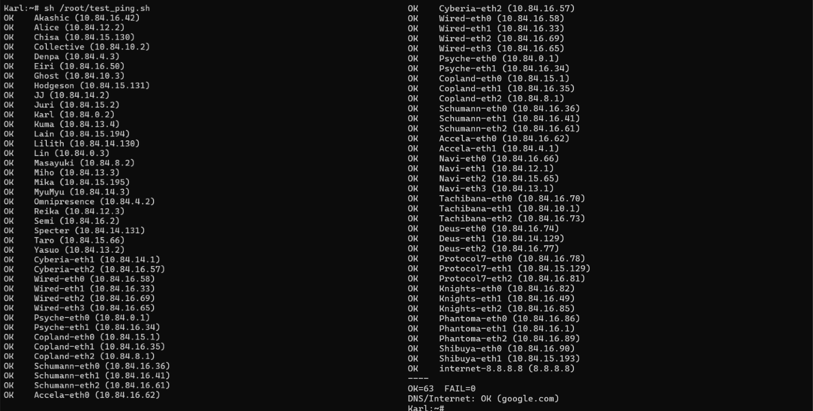
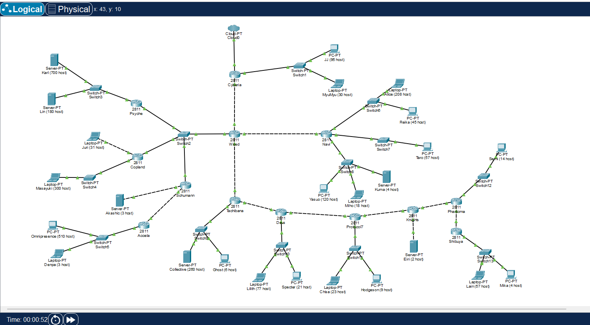
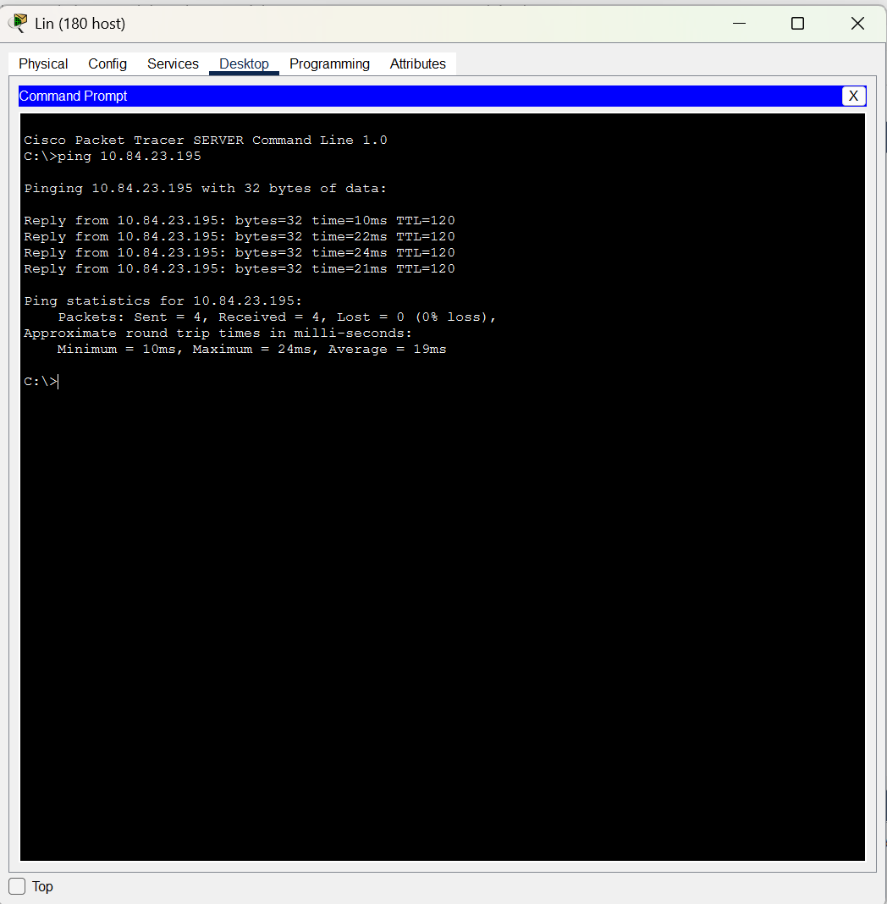
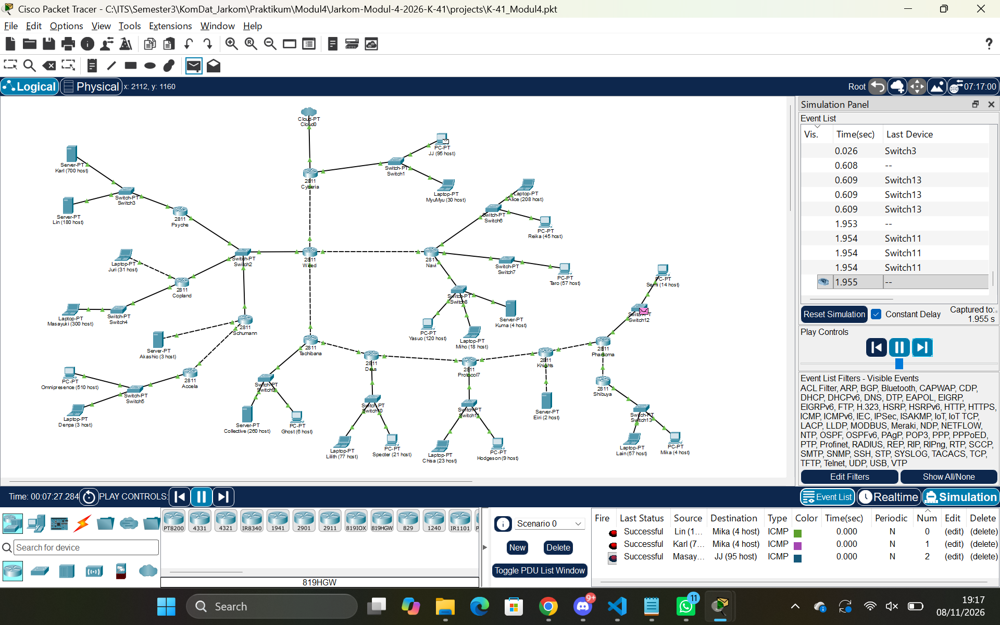

# Jarkom-Modul-4-2026-K-41

|         Nama         |     NRP     |
|----------------------|-------------|
|Aliya Rahmadina       | 5027251056  |
|Rayhan Fadhilah Allayn| 5027251126  |

## Laporan
[SPREADSHEET](K-41_Spreadsheet%20Modul%204%20Komdat%20Jarkom%202026.xlsx)

Pada "Serial Experiments Lain, Layer 04: The Wired Expansion", jaringan The Wired diperluas. Hanya router Cyberia yang terhubung ke dunia luar (NAT pada GNS3, Cloud pada CPT), lalu seluruh lalu lintas mengalir ke Wired yang bercabang ke Navi, Tachibana, dan satu segmen bersama Psyche, Copland, serta Schumann. Tugasnya adalah membagi alamat IP dan menyusun routing seefisien mungkin pada prefix `10.84.0.0` sehingga tidak ada alamat yang terbuang dan tidak ada entitas yang terisolasi. Topologi yang sama dikerjakan dua kali dengan metode classless yang berbeda.

## GNS3 - VLSM

### 1. Topologi GNS3
Topologi terdiri atas 13 router, 13 switch, 25 node (host/server), dan 1 node NAT


Setelah dianalisis, terdapat 25 subnet (A1 sampai A25). Berikut topologi dengan keterangan subnet:


### 2. Total penggunaan subnet
Total subnet adalah 25 subnet, dengan total blok yang dialokasikan 4.188 IP. Karena 4.188 lebih besar dari 4.096 dan lebih kecil dari 8.192, pendekatan terkecil yang memuat seluruh jaringan adalah /19 (`10.84.0.0/19`). Detail perhitungan ada pada spreadsheet di atas.

Berikut VLSM tree-nya:


### 3. Langkah Perhitungan VLSM

**Langkah 1 - Hitung kebutuhan IP tiap subnet.**
Kebutuhan IP = jumlah host + jumlah interface router pada subnet tersebut.

- Contoh A4 (Psyche - Switch3 - Karl, Lin): 700 + 180 + 1 interface Psyche = **881**.
- Link router-router tidak memiliki host, sehingga kebutuhannya **2** IP (satu interface per router).
- Subnet Switch2 (A3) menghubungkan 4 router, sehingga kebutuhannya **4** IP.

**Langkah 2 - Tentukan prefix.**
Cari blok 2^n terkecil yang memuat kebutuhan IP + 2 (satu untuk Network ID dan satu untuk Broadcast). Prefix = 32 - n.

- A4: 881 + 2 = 883, blok terkecil yang muat 1.024 (2^10), jadi **/22**.
- A5: 32 + 2 = 34 > 32, jadi tidak muat di /27 (32 alamat), naik ke 64 alamat, jadi **/26**.
- A21: 3 + 2 = 5, tidak muat di /30 (4 alamat), jadi **/29** (8 alamat).

**Langkah 3 - Urutkan dari blok terbesar ke terkecil.**
Subnet dengan ukuran yang sama diurutkan berdasarkan nomor subnet.

Alasannya: blok berukuran 2^n harus dimulai di alamat yang habis dibagi 2^n. Kalau dimulai dari blok terbesar, alamat awal tiap blok berikutnya otomatis rata, sehingga tidak ada celah atau alamat terbuang.

**Langkah 4 - Tentukan root.**
Total kebutuhan IP seluruh subnet adalah 2.814, tetapi tiap subnet dialokasikan satu blok penuh (dibulatkan ke 2^n). Total ukuran blok:

2x1024 (/22) + 2x512 (/23) + 2x256 (/24) + 2x128 (/25) + 4x64 (/26) + 32 (/27) + 3x8 (/29) + 9x4 (/30) = **4.188** alamat.

Karena 4.188 > 4.096 (/20) dan < 8.192 (/19), root terkecil yang memuat semuanya adalah **10.84.0.0/19**.

**Langkah 5 - Alokasikan berurutan dari 10.84.0.0.**
Network ID blok pertama = 10.84.0.0. Network ID blok berikutnya = Broadcast blok sebelumnya + 1.

- Broadcast = Network ID + ukuran blok - 1
- Range IP host = Network ID + 1 sampai Broadcast - 1
- Netmask mengikuti prefix (/22 = 255.255.252.0, /23 = 255.255.254.0, dst.)

Contoh A4 (/22, 1.024 alamat): Network ID 10.84.0.0, Broadcast 10.84.3.255, range host 10.84.0.1 - 10.84.3.254. Network ID A9 = 10.84.3.255 + 1 = 10.84.4.0. Blok terakhir (A24, /30) berakhir di 10.84.16.91, masih di dalam 10.84.0.0/19.

### 4. Command
**Cyberia** (`cyberia.sh`)

```
#!/bin/sh

# eth0 -> NAT (DHCP dari GNS3 NAT)
ip link set eth0 up
if command -v udhcpc >/dev/null 2>&1; then
    udhcpc -i eth0 -n -q >/dev/null 2>&1
elif command -v dhclient >/dev/null 2>&1; then
    dhclient eth0 >/dev/null 2>&1
fi

ip -4 addr show dev eth0 | grep -q 'inet ' || ip addr add 192.168.122.2/24 dev eth0
GW=$(ip route | awk '/^default/ {print $3; exit}')
[ -z "$GW" ] && GW=192.168.122.1
ip route replace default via "$GW" dev eth0
echo "nameserver 8.8.8.8" > /etc/resolv.conf

# Alamat IP interface
# eth1 -> Switch1
ip link set eth1 up
ip addr flush dev eth1
ip addr add 10.84.14.1/25 dev eth1
# eth2 -> langsung ke Wired
ip link set eth2 up
ip addr flush dev eth2
ip addr add 10.84.16.57/30 dev eth2

# IP forwarding 
sysctl -w net.ipv4.ip_forward=1 >/dev/null 2>&1 || echo 1 > /proc/sys/net/ipv4/ip_forward

# Static routing 
ip route replace 10.84.0.0/19 via 10.84.16.58      

# NAT
if ! command -v iptables >/dev/null 2>&1; then
    if command -v apk >/dev/null 2>&1; then apk add --no-cache iptables
    elif command -v apt-get >/dev/null 2>&1; then apt-get update && apt-get install -y iptables
    fi
fi
iptables -t nat -C POSTROUTING -o eth0 -s 10.84.0.0/19 -j MASQUERADE 2>/dev/null || \
iptables -t nat -A POSTROUTING -o eth0 -s 10.84.0.0/19 -j MASQUERADE

# Cek hasil 
ip addr | grep "inet "
ip route
```

**Wired** (`wired.sh`)

```
#!/bin/sh

# Alamat IP interface
# eth0 -> langsung ke Cyberia
ip link set eth0 up
ip addr flush dev eth0
ip addr add 10.84.16.58/30 dev eth0
# eth1 -> Switch2
ip link set eth1 up
ip addr flush dev eth1
ip addr add 10.84.16.33/29 dev eth1
# eth2 -> langsung ke Tachibana
ip link set eth2 up
ip addr flush dev eth2
ip addr add 10.84.16.69/30 dev eth2
# eth3 -> langsung ke Navi
ip link set eth3 up
ip addr flush dev eth3
ip addr add 10.84.16.65/30 dev eth3

# IP forwarding
sysctl -w net.ipv4.ip_forward=1 >/dev/null 2>&1 || echo 1 > /proc/sys/net/ipv4/ip_forward

# Static routing
ip route replace default via 10.84.16.57            # ke atas via Cyberia
ip route replace 10.84.0.0/22 via 10.84.16.34       # via Psyche (A4)
ip route replace 10.84.8.0/23 via 10.84.16.35       # via Copland (A6)
ip route replace 10.84.15.0/26 via 10.84.16.35      # via Copland (A5)
ip route replace 10.84.4.0/22 via 10.84.16.36       # via Schumann (A9)
ip route replace 10.84.16.40/29 via 10.84.16.36     # via Schumann (A7)
ip route replace 10.84.16.60/30 via 10.84.16.36     # via Schumann (A8)
ip route replace 10.84.12.0/23 via 10.84.16.66      # via Navi (A11, A13)
ip route replace 10.84.15.64/26 via 10.84.16.66     # via Navi (A12)
ip route replace 10.84.10.0/23 via 10.84.16.70      # via Tachibana (A15)
ip route replace 10.84.14.128/25 via 10.84.16.70    # via Tachibana (A17)
ip route replace 10.84.15.128/25 via 10.84.16.70    # via Tachibana (A19, A25)
ip route replace 10.84.16.0/27 via 10.84.16.70      # via Tachibana (A23)
ip route replace 10.84.16.48/29 via 10.84.16.70     # via Tachibana (A21)
ip route replace 10.84.16.72/29 via 10.84.16.70     # via Tachibana (A16, A18)
ip route replace 10.84.16.80/29 via 10.84.16.70     # via Tachibana (A20, A22)
ip route replace 10.84.16.88/30 via 10.84.16.70     # via Tachibana (A24)

# DNS
echo "nameserver 8.8.8.8" > /etc/resolv.conf

# Cek hasil
ip addr | grep "inet "
ip route
```

### 5. Verifikasi

Pengujian dilakukan dari Karl dengan `test_ping.sh`, yang melakukan ping ke seluruh host, seluruh antarmuka router, dan `8.8.8.8`, kemudian menguji DNS ke `google.com`.

**Karl** (`test_ping.sh`)
```
#!/bin/sh

ok=0; fail=0
while read name ip; do
    [ -z "$name" ] && continue
    if ping -c 1 -W 2 "$ip" >/dev/null 2>&1; then
        echo "OK    $name ($ip)"; ok=$((ok+1))
    else
        echo "FAIL  $name ($ip)"; fail=$((fail+1))
    fi
done <<EOF
Akashic 10.84.16.42
Alice 10.84.12.2
Chisa 10.84.15.130
Collective 10.84.10.2
Denpa 10.84.4.3
Eiri 10.84.16.50
Ghost 10.84.10.3
Hodgeson 10.84.15.131
JJ 10.84.14.2
Juri 10.84.15.2
Karl 10.84.0.2
Kuma 10.84.13.4
Lain 10.84.15.194
Lilith 10.84.14.130
Lin 10.84.0.3
Masayuki 10.84.8.2
Miho 10.84.13.3
Mika 10.84.15.195
MyuMyu 10.84.14.3
Omnipresence 10.84.4.2
Reika 10.84.12.3
Semi 10.84.16.2
Specter 10.84.14.131
Taro 10.84.15.66
Yasuo 10.84.13.2
Cyberia-eth1 10.84.14.1
Cyberia-eth2 10.84.16.57
Wired-eth0 10.84.16.58
Wired-eth1 10.84.16.33
Wired-eth2 10.84.16.69
Wired-eth3 10.84.16.65
Psyche-eth0 10.84.0.1
Psyche-eth1 10.84.16.34
Copland-eth0 10.84.15.1
Copland-eth1 10.84.16.35
Copland-eth2 10.84.8.1
Schumann-eth0 10.84.16.36
Schumann-eth1 10.84.16.41
Schumann-eth2 10.84.16.61
Accela-eth0 10.84.16.62
Accela-eth1 10.84.4.1
Navi-eth0 10.84.16.66
Navi-eth1 10.84.12.1
Navi-eth2 10.84.15.65
Navi-eth3 10.84.13.1
Tachibana-eth0 10.84.16.70
Tachibana-eth1 10.84.10.1
Tachibana-eth2 10.84.16.73
Deus-eth0 10.84.16.74
Deus-eth1 10.84.14.129
Deus-eth2 10.84.16.77
Protocol7-eth0 10.84.16.78
Protocol7-eth1 10.84.15.129
Protocol7-eth2 10.84.16.81
Knights-eth0 10.84.16.82
Knights-eth1 10.84.16.49
Knights-eth2 10.84.16.85
Phantoma-eth0 10.84.16.86
Phantoma-eth1 10.84.16.1
Phantoma-eth2 10.84.16.89
Shibuya-eth0 10.84.16.90
Shibuya-eth1 10.84.15.193
internet-8.8.8.8 8.8.8.8
EOF
echo "----"
echo "OK=$ok  FAIL=$fail"

# tes DNS + internet
ping -c 1 -W 3 google.com >/dev/null 2>&1 && echo "DNS/Internet: OK (google.com)" || echo "DNS/Internet: FAIL (google.com)"
```



## CPT - CIDR
 
Topologi yang sama dikerjakan di Cisco Packet Tracer dengan metode CIDR, kebalikan dari GNS3 yang memakai VLSM. Pada CIDR, subnet digabung dari ujung topologi terjauh dari Cloud menuju Cyberia sampai menjadi satu blok, lalu alamat dialokasikan turun mengikuti pohon penggabungan tersebut. Dengan cara ini setiap cabang menempati satu blok alamat, sehingga tabel routing dapat diringkas. Hasil perhitungan ada pada sheet `Rute`, `Penggabungan - CIDR`, dan `Pembagian IP - CIDR` di spreadsheet di atas. Project CPT ada pada `projects/K-41_Modul4.pkt` dan skrip konfigurasi router pada `scripts/cidr_cpt/`.
 
### 1. Topologi CPT
Topologi terdiri atas 13 router 2811 (masing-masing dipasangi modul NM-2FE2W), 13 switch (Switch-PT), 25 node (6 server, 9 laptop, 10 PC), dan 1 Cloud-PT yang hanya terhubung ke Cyberia. Kabel cross-over dipakai untuk link router ke router dan router ke node secara langsung, sedangkan kabel straight-through dipakai untuk router ke switch dan switch ke node.
 
<!-- SCREENSHOT 1: topologi CPT (semua link hijau) -->

 
### 2. Total penggunaan subnet
Subnet sama dengan pada VLSM, yaitu 25 subnet (A1 sampai A25) dengan total blok 4.188 IP, sehingga root terkecil yang memuat seluruh jaringan adalah /19 (`10.84.0.0/19`). Kebutuhan IP dan prefix tiap subnet dihitung dengan cara yang sama seperti pada langkah 1 dan 2 VLSM, dan hasilnya ada pada sheet `Rute`.
 
### 3. Langkah Perhitungan CIDR
 
**Langkah 1 - Gunakan kebutuhan IP dan prefix tiap subnet.**
Kebutuhan IP = jumlah host + jumlah interface router pada subnet tersebut, lalu dicarikan blok 2^n terkecil yang muat (kebutuhan + 2). Contoh A4 = 881 IP menjadi /22, A5 = 32 IP menjadi /26, dan A21 = 3 IP menjadi /29.
 
**Langkah 2 - Terapkan aturan penggabungan.**
Dua subnet digabung menjadi satu blok dengan netmask satu tingkat di atas komponen yang terbesar, yaitu prefix terkecil dikurangi 1. Penggabungan dimulai dari subnet yang paling jauh dari Cloud, kemudian dinaikkan sampai tersisa satu blok.
 
- A24 (/30) + A22 (/30) menjadi B1 (/29), karena kedua komponen sama besar.
- A6 (/23) + A5 (/26) menjadi B6 (/22), karena komponen terbesarnya /23, sehingga hasilnya satu tingkat di atasnya.
**Langkah 3 - Tentukan urutan penggabungan.**
Penggabungan disusun dengan tiga prinsip:
 
1. Subnet digabung per cabang dan dimulai dari ujung rantai Tachibana (Shibuya) agar hasil tiap cabang menjadi satu blok.
2. Subnet berukuran kecil (/30 dan /29) digabung lebih dulu dengan sesama subnet kecil, supaya blok yang besar tidak naik satu tingkat hanya karena kelebihan beberapa IP.
3. Setiap cabang yang keluar dari Wired (Psyche, Copland, Schumann, Navi, Tachibana) dijaga tetap menjadi satu blok sendiri, sehingga Wired cukup memiliki satu rute untuk tiap cabang. Subnet kecil di sekitar Wired (A1, A2, A3, dan A14) digabung menjadi satu blok D2 yang menumpang pada sisa ruang blok timur.
Hasil penggabungan (sesuai sheet `Penggabungan - CIDR`):
 
**Tahap I**
 
| Subnet | Gabungan dari 1 | Gabungan dari 2 | Netmask akhir | Network ID |
|---|---|---|---|---|
| B1 | A24 (/30) | A22 (/30) | /29 | 10.84.23.160/29 |
| B2 | A19 (/26) | A20 (/30) | /25 | 10.84.23.0/25 |
| B3 | A18 (/30) | A16 (/30) | /29 | 10.84.22.128/29 |
| B4 | A12 (/26) | A10 (/30) | /25 | 10.84.18.0/25 |
| B5 | A11 (/24) | A13 (/24) | /23 | 10.84.16.0/23 |
| B6 | A6 (/23) | A5 (/26) | /22 | 10.84.4.0/22 |
| B7 | A7 (/29) | A8 (/30) | /28 | 10.84.12.0/28 |
| B8 | A2 (/30) | A14 (/30) | /29 | 10.84.24.128/29 |
 
**Tahap II**
 
| Subnet | Gabungan dari 1 | Gabungan dari 2 | Netmask akhir | Network ID |
|---|---|---|---|---|
| C1 | B1 (/29) | A21 (/29) | /28 | 10.84.23.160/28 |
| C2 | A17 (/25) | B3 (/29) | /24 | 10.84.22.0/24 |
| C3 | B5 (/23) | B4 (/25) | /22 | 10.84.16.0/22 |
| C4 | A9 (/22) | B7 (/28) | /21 | 10.84.8.0/21 |
| C5 | B8 (/29) | A3 (/29) | /28 | 10.84.24.128/28 |
| C6 | A4 (/22) | B6 (/22) | /21 | 10.84.0.0/21 |
 
**Tahap III**
 
| Subnet | Gabungan dari 1 | Gabungan dari 2 | Netmask akhir | Network ID |
|---|---|---|---|---|
| D1 | A23 (/27) | C1 (/28) | /26 | 10.84.23.128/26 |
| D2 | A1 (/25) | C5 (/28) | /24 | 10.84.24.0/24 |
| D3 | C6 (/21) | C4 (/21) | /20 | 10.84.0.0/20 |
 
**Tahap IV**
 
| Subnet | Gabungan dari 1 | Gabungan dari 2 | Netmask akhir | Network ID |
|---|---|---|---|---|
| E1 | D1 (/26) | A25 (/26) | /25 | 10.84.23.128/25 |
 
**Tahap V**
 
| Subnet | Gabungan dari 1 | Gabungan dari 2 | Netmask akhir | Network ID |
|---|---|---|---|---|
| F1 | B2 (/25) | E1 (/25) | /24 | 10.84.23.0/24 |
 
**Tahap VI**
 
| Subnet | Gabungan dari 1 | Gabungan dari 2 | Netmask akhir | Network ID |
|---|---|---|---|---|
| G1 | C2 (/24) | F1 (/24) | /23 | 10.84.22.0/23 |
 
**Tahap VII**
 
| Subnet | Gabungan dari 1 | Gabungan dari 2 | Netmask akhir | Network ID |
|---|---|---|---|---|
| H1 | A15 (/23) | G1 (/23) | /22 | 10.84.20.0/22 |
 
**Tahap VIII**
 
| Subnet | Gabungan dari 1 | Gabungan dari 2 | Netmask akhir | Network ID |
|---|---|---|---|---|
| I1 | C3 (/22) | H1 (/22) | /21 | 10.84.16.0/21 |
 
**Tahap IX**
 
| Subnet | Gabungan dari 1 | Gabungan dari 2 | Netmask akhir | Network ID |
|---|---|---|---|---|
| J1 | I1 (/21) | D2 (/24) | /20 | 10.84.16.0/20 |
 
**Tahap X**
 
| Subnet | Gabungan dari 1 | Gabungan dari 2 | Netmask akhir | Network ID |
|---|---|---|---|---|
| K1 | D3 (/20) | J1 (/20) | /19 | 10.84.0.0/19 |
 
**Langkah 4 - Pohon CIDR.**
Root K1 adalah `10.84.0.0/19`. Setiap simpul adalah hasil penggabungan, dan daun adalah subnet A1 sampai A25.
 
```
K1  10.84.0.0/19
├── D3  10.84.0.0/20
│   ├── C6  10.84.0.0/21
│   │   ├── A4  10.84.0.0/22  (Psyche > Switch3 > Karl, Lin)
│   │   └── B6  10.84.4.0/22
│   │       ├── A6  10.84.4.0/23  (Copland > Switch4 > Masayuki)
│   │       └── A5  10.84.6.0/26  (Copland > Juri)
│   └── C4  10.84.8.0/21
│       ├── A9  10.84.8.0/22  (Accela > Switch5 > Omnipresence, Denpa)
│       └── B7  10.84.12.0/28
│           ├── A7  10.84.12.0/29  (Schumann > Akashic)
│           └── A8  10.84.12.8/30  (Schumann > Accela)
└── J1  10.84.16.0/20
    ├── I1  10.84.16.0/21
    │   ├── C3  10.84.16.0/22
    │   │   ├── B5  10.84.16.0/23
    │   │   │   ├── A11  10.84.16.0/24  (Navi > Switch6 > Alice, Reika)
    │   │   │   └── A13  10.84.17.0/24  (Navi > Switch8 > Yasuo, Miho, Kuma)
    │   │   └── B4  10.84.18.0/25
    │   │       ├── A12  10.84.18.0/26  (Navi > Switch7 > Taro)
    │   │       └── A10  10.84.18.64/30  (Wired > Navi)
    │   └── H1  10.84.20.0/22
    │       ├── A15  10.84.20.0/23  (Tachibana > Switch9 > Collective, Ghost)
    │       └── G1  10.84.22.0/23
    │           ├── C2  10.84.22.0/24
    │           │   ├── A17  10.84.22.0/25  (Deus > Switch10 > Lilith, Specter)
    │           │   └── B3  10.84.22.128/29
    │           │       ├── A18  10.84.22.128/30  (Deus > Protocol7)
    │           │       └── A16  10.84.22.132/30  (Tachibana > Deus)
    │           └── F1  10.84.23.0/24
    │               ├── B2  10.84.23.0/25
    │               │   ├── A19  10.84.23.0/26  (Protocol7 > Switch11 > Chisa, Hodgeson)
    │               │   └── A20  10.84.23.64/30  (Protocol7 > Knights)
    │               └── E1  10.84.23.128/25
    │                   ├── D1  10.84.23.128/26
    │                   │   ├── A23  10.84.23.128/27  (Phantoma > Switch12 > Semi)
    │                   │   └── C1  10.84.23.160/28
    │                   │       ├── B1  10.84.23.160/29
    │                   │       │   ├── A24  10.84.23.160/30  (Phantoma > Shibuya)
    │                   │       │   └── A22  10.84.23.164/30  (Knights > Phantoma)
    │                   │       └── A21  10.84.23.168/29  (Knights > Eiri)
    │                   └── A25  10.84.23.192/26  (Shibuya > Switch13 > Lain, Mika)
    └── D2  10.84.24.0/24
        ├── A1  10.84.24.0/25  (Cyberia > JJ, MyuMyu)
        └── C5  10.84.24.128/28
            ├── B8  10.84.24.128/29
            │   ├── A2  10.84.24.128/30  (Cyberia > Wired)
            │   └── A14  10.84.24.132/30  (Wired > Tachibana)
            └── A3  10.84.24.136/29  (Wired > Switch2 > Psyche, Copland, Schumann)
```
 
**Langkah 5 - Alokasikan alamat dari pohon.**
Alokasi dimulai dari Network ID root `10.84.0.0`. Pada tiap simpul, komponen yang lebih besar menempati alamat lebih rendah, sedangkan komponen yang lebih kecil dimulai di awal separuh kedua blok. Dengan aturan ini setiap Network ID selalu selaras dengan netmask-nya.
 
- Broadcast = Network ID + ukuran blok - 1
- Range IP host = Network ID + 1 sampai Broadcast - 1
Contoh A1 (/25): K1 `10.84.0.0/19` terbagi menjadi D3 (`10.84.0.0/20`) dan J1 (`10.84.16.0/20`). J1 terbagi menjadi I1 (`10.84.16.0/21`) dan D2 (`10.84.24.0/24`). D2 terbagi menjadi A1 (`10.84.24.0/25`) dan C5 (`10.84.24.128/28`). Jadi Network ID A1 = 10.84.24.0, Broadcast = 10.84.24.127, dan range host 10.84.24.1 - 10.84.24.126.
 
Tabel lengkap seluruh subnet ada pada sheet `Pembagian IP - CIDR`, dan pengelompokan per sayap topologi pada sheet `(Revisi) Pembagian IP - CIDR`.
 
### 4. Routing
Routing dibuat statis dan seefisien mungkin dengan memanfaatkan blok hasil penggabungan: setiap router memakai satu rute ringkas untuk tiap cabang di bawahnya, dan satu default route ke router di atasnya. Cloud0 tidak dikonfigurasi, dan pada Cyberia interface `FastEthernet0/0` hanya dinyalakan (`no shutdown`) tanpa IP.
 
| Router | Rute statis (tujuan via next-hop) |
|---|---|
| Cyberia | `10.84.0.0/19` via `10.84.24.130` |
| Wired | `10.84.0.0/22` via `10.84.24.138`<br>`10.84.4.0/22` via `10.84.24.139`<br>`10.84.8.0/21` via `10.84.24.140`<br>`10.84.16.0/22` via `10.84.18.66`<br>`10.84.20.0/22` via `10.84.24.134`<br>`0.0.0.0/0` via `10.84.24.129` |
| Psyche | `0.0.0.0/0` via `10.84.24.137` |
| Copland | `0.0.0.0/0` via `10.84.24.137` |
| Schumann | `10.84.8.0/22` via `10.84.12.10`<br>`0.0.0.0/0` via `10.84.24.137` |
| Accela | `0.0.0.0/0` via `10.84.12.9` |
| Navi | `0.0.0.0/0` via `10.84.18.65` |
| Tachibana | `10.84.22.0/23` via `10.84.22.134`<br>`0.0.0.0/0` via `10.84.24.133` |
| Deus | `10.84.23.0/24` via `10.84.22.130`<br>`0.0.0.0/0` via `10.84.22.133` |
| Protocol7 | `10.84.23.128/25` via `10.84.23.66`<br>`0.0.0.0/0` via `10.84.22.129` |
| Knights | `10.84.23.128/25` via `10.84.23.166`<br>`0.0.0.0/0` via `10.84.23.65` |
| Phantoma | `10.84.23.192/26` via `10.84.23.162`<br>`0.0.0.0/0` via `10.84.23.165` |
| Shibuya | `0.0.0.0/0` via `10.84.23.161` |
 
Wired yang menghubungkan 25 subnet hanya memerlukan 5 rute ringkas dan 1 default route.
 
### 5. Command
Skrip untuk setiap router ada pada folder `scripts/cidr_cpt/`. Nama interface pada skrip mengikuti sambungan kabel pada topologi CPT. Contoh dua router utama:
 
**Cyberia** (`cyberia.sh`)
 
```
enable
configure terminal
hostname Cyberia
no ip domain-lookup
interface FastEthernet0/0
 description ke Cloud0 (tanpa IP)
 no shutdown
 exit
interface FastEthernet0/1
 description A1 ke Switch1
 ip address 10.84.24.1 255.255.255.128
 no shutdown
 exit
interface FastEthernet1/0
 description A2 ke Wired
 ip address 10.84.24.129 255.255.255.252
 no shutdown
 exit
ip route 10.84.0.0 255.255.224.0 10.84.24.130
end
write memory
```
 
**Wired** (`wired.sh`)
 
```
enable
configure terminal
hostname Wired
no ip domain-lookup
interface FastEthernet0/0
 description A2 ke Cyberia
 ip address 10.84.24.130 255.255.255.252
 no shutdown
 exit
interface FastEthernet0/1
 description A14 ke Tachibana
 ip address 10.84.24.133 255.255.255.252
 no shutdown
 exit
interface FastEthernet1/0
 description A10 ke Navi
 ip address 10.84.18.65 255.255.255.252
 no shutdown
 exit
interface FastEthernet1/1
 description A3 ke Switch2 (segmen bersama)
 ip address 10.84.24.137 255.255.255.248
 no shutdown
 exit
ip route 10.84.0.0 255.255.252.0 10.84.24.138
ip route 10.84.4.0 255.255.252.0 10.84.24.139
ip route 10.84.8.0 255.255.248.0 10.84.24.140
ip route 10.84.16.0 255.255.252.0 10.84.18.66
ip route 10.84.20.0 255.255.252.0 10.84.24.134
ip route 0.0.0.0 0.0.0.0 10.84.24.129
end
write memory
```
 
Konfigurasi PC, laptop, dan server (diisi pada IP Configuration untuk PC dan laptop, serta pada Config untuk server):
 
| Node | Subnet | IP address | Netmask | Default gateway |
|---|---|---|---|---|
| JJ | A1 | 10.84.24.2 | 255.255.255.128 | 10.84.24.1 |
| MyuMyu | A1 | 10.84.24.3 | 255.255.255.128 | 10.84.24.1 |
| Karl | A4 | 10.84.0.2 | 255.255.252.0 | 10.84.0.1 |
| Lin | A4 | 10.84.0.3 | 255.255.252.0 | 10.84.0.1 |
| Juri | A5 | 10.84.6.2 | 255.255.255.192 | 10.84.6.1 |
| Masayuki | A6 | 10.84.4.2 | 255.255.254.0 | 10.84.4.1 |
| Akashic | A7 | 10.84.12.2 | 255.255.255.248 | 10.84.12.1 |
| Omnipresence | A9 | 10.84.8.2 | 255.255.252.0 | 10.84.8.1 |
| Denpa | A9 | 10.84.8.3 | 255.255.252.0 | 10.84.8.1 |
| Alice | A11 | 10.84.16.2 | 255.255.255.0 | 10.84.16.1 |
| Reika | A11 | 10.84.16.3 | 255.255.255.0 | 10.84.16.1 |
| Taro | A12 | 10.84.18.2 | 255.255.255.192 | 10.84.18.1 |
| Yasuo | A13 | 10.84.17.2 | 255.255.255.0 | 10.84.17.1 |
| Miho | A13 | 10.84.17.3 | 255.255.255.0 | 10.84.17.1 |
| Kuma | A13 | 10.84.17.4 | 255.255.255.0 | 10.84.17.1 |
| Collective | A15 | 10.84.20.2 | 255.255.254.0 | 10.84.20.1 |
| Ghost | A15 | 10.84.20.3 | 255.255.254.0 | 10.84.20.1 |
| Lilith | A17 | 10.84.22.2 | 255.255.255.128 | 10.84.22.1 |
| Specter | A17 | 10.84.22.3 | 255.255.255.128 | 10.84.22.1 |
| Chisa | A19 | 10.84.23.2 | 255.255.255.192 | 10.84.23.1 |
| Hodgeson | A19 | 10.84.23.3 | 255.255.255.192 | 10.84.23.1 |
| Eiri | A21 | 10.84.23.170 | 255.255.255.248 | 10.84.23.169 |
| Semi | A23 | 10.84.23.130 | 255.255.255.224 | 10.84.23.129 |
| Lain | A25 | 10.84.23.194 | 255.255.255.192 | 10.84.23.193 |
| Mika | A25 | 10.84.23.195 | 255.255.255.192 | 10.84.23.193 |
 
### 6. Verifikasi
Pengujian dilakukan dari Karl dengan ping ke host pada setiap cabang, serta `tracert` ke Mika sebagai jalur terjauh. Jalur yang seharusnya ditempuh dari Karl ke Mika adalah Psyche, Wired, Tachibana, Deus, Protocol7, Knights, Phantoma, kemudian Shibuya.
 




 
### 7. Perbandingan dengan VLSM
 
| | VLSM (GNS3) | CIDR (CPT) |
|---|---|---|
| Root | 10.84.0.0/19 | 10.84.0.0/19 |
| Alamat yang ditempati | 10.84.0.0 sampai 10.84.16.91 | 10.84.0.0 sampai 10.84.24.143 |
| Rute pada Wired | 1 default + 16 rute | 1 default + 5 rute |
 
VLSM menempatkan alamat paling rapat, sedangkan CIDR menyisakan lebih banyak ruang karena tiap cabang dijaga tetap menjadi satu blok, sebagai gantinya tabel routing menjadi jauh lebih ringkas.
 
